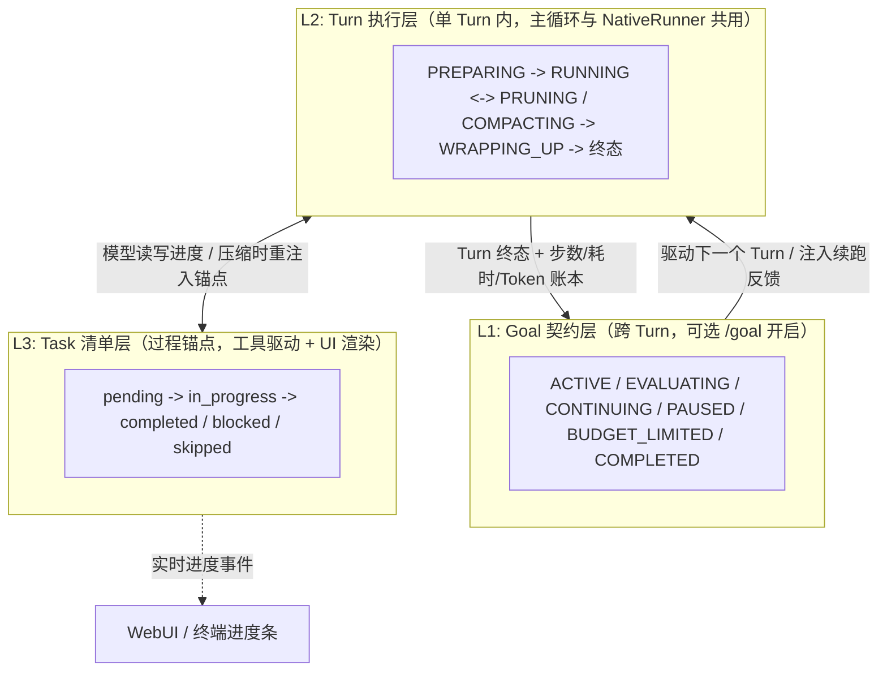
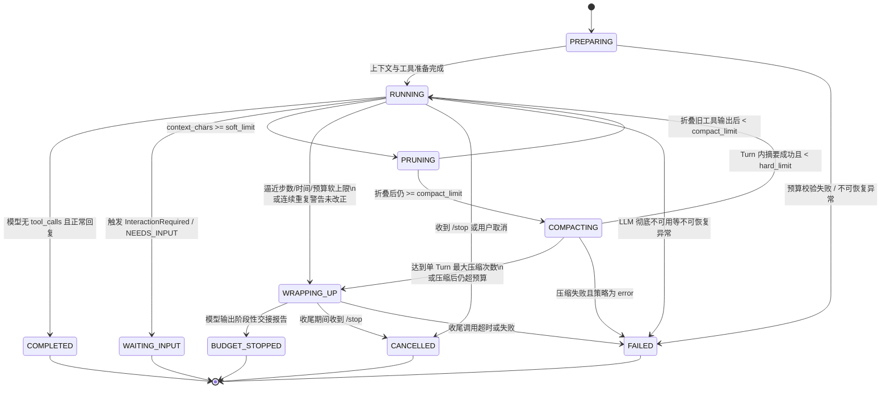
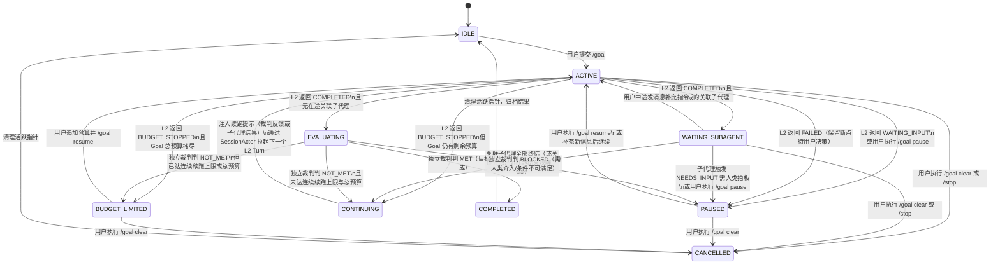
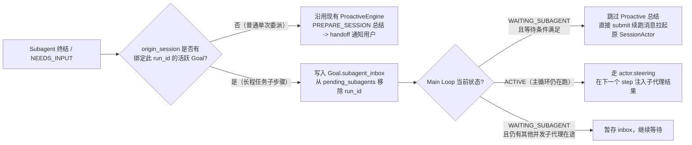
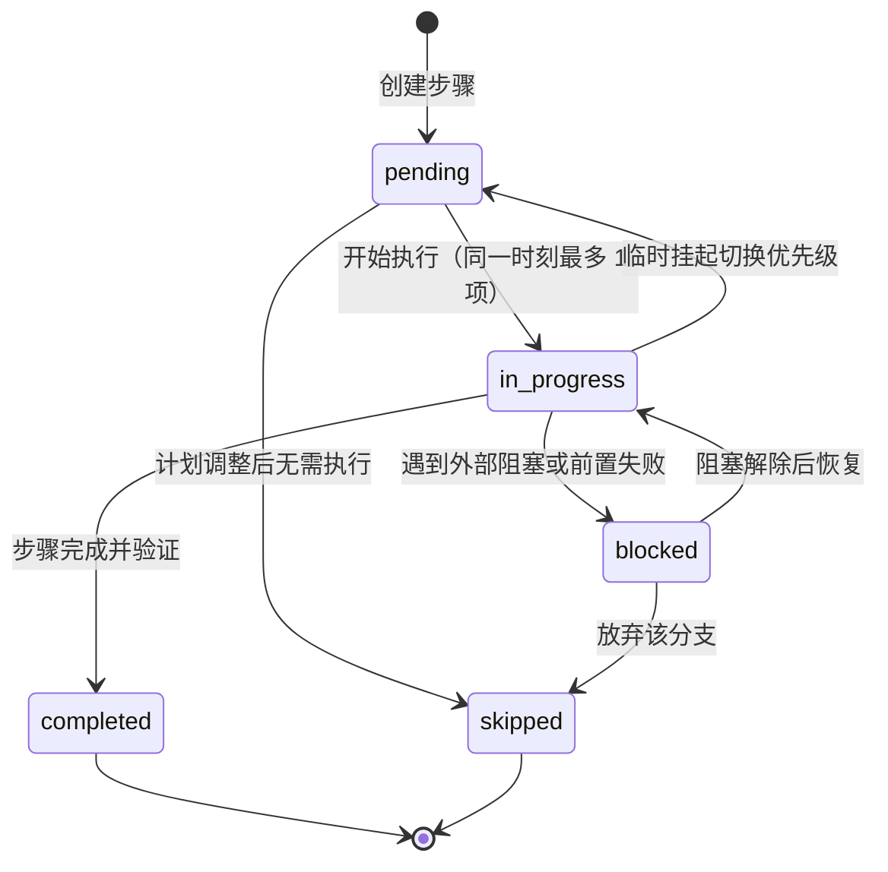

# 长程任务执行与状态机设计

日期：2026-11-26　状态：草案（Design Spec）

## 背景与问题

当前 ShiritaiBot 的主循环（`AgentRuntime._turn`）与原生子代理（`NativeRunner.run`）围绕单次对话 Turn 设计。执行需要数十步、跨多轮验证或需要委派子代理协作的长程任务时，存在五个硬中断点：

1. **步数超限直接抛错**：循环跑满 `policy.max_steps`（默认 25）后直接 `raise PublicError("agent.stepLimit")`，不给模型收尾和交接机会。
2. **Turn 内上下文只涨不压**：`ContextManager.prepare()` 仅在 Turn 开始前按 Turn 粒度执行压缩/丢弃（且默认 `strategy = "discard"`）；进入工具循环后 `context_chars(history)` 一旦超过 `max_context_chars * 2` 直接抛 `contextLimit` / `contextFull`。`NativeRunner` 更是未接入摘要压缩。
3. **墙钟超时硬打断**：`asyncio.timeout(max_turn_seconds)` 到期直接失败，无法产出阶段性汇总。
4. **子代理回流断裂（只总结不续跑）**：主循环异步委派子代理后即结束当前 Turn；子代理完成后事件进入 `ProactiveEngine`，在隔离的 `PREPARE_SESSION` 中生成通知并通过 `handoff()` 写入主会话历史，**但不会重新拉起主循环的 `SessionActor` 继续执行后续步骤**。
5. **缺少任务锚点与续跑契约**：重复工具指纹累计 5 次直接熔断（容易误杀 `pytest` 等循环验证）；没有内置的 Task 清单工具，也没有跨 Turn 的 `/goal` 续跑机制。

### 设计原则

- **压缩优先于抛错**：Turn 内上下文逼近上限时，先折叠旧工具输出，再做增量摘要，只有在彻底无法腾出空间或连续失败时才熔断。
- **软着陆优先于硬杀**：触及步数、时间或预算边界时，进入收尾态（`WRAPPING_UP`）产出结构化交接报告，而不是裸抛异常。
- **三层职责解耦**：把「跨 Turn 目标契约」「单 Turn 执行循环」「过程待办清单」拆成三层正交状态机，主循环与原生 Subagent 共用同一套 L2 执行语义。

---

## 整体三层架构

| 层级 | 作用域 | 核心职责 | 是否必选 |
| --- | --- | --- | --- |
| **L1 Goal 契约层** | 跨多个 Turn（绑定 `session`） | 定义不可被模型篡改的终态条件、总预算与暂停/恢复；Turn 结束后决定是否续跑 | 可选（由 `/goal` 开启；普通对话直通 L2） |
| **L2 Turn 执行层** | 单次 Turn / 单次 `NativeRunner` 运行 | 驱动 LLM 与工具循环、Turn 内两级上下文压缩、防死循环治理、触顶软着陆 | 始终生效 |
| **L3 Task 清单层** | 会话级 / Goal 级工作记忆 | 过程步骤拆解与勾选、对抗上下文压缩失忆、向用户实时展示进度 | 按需由模型调用工具触发 |

---

## L2：Turn 执行状态机（核心）

L2 替代现有的线性 `for step in range(max_steps)` 硬循环，使单次 Turn 在面对长上下文、高步数或临近超时时能够自我降载并优雅结束。

### 1. 状态定义与职责

| 状态 | 含义 | 允许的动作 |
| --- | --- | --- |
| `PREPARING` | Turn 初始化 | 执行跨 Turn `ContextManager.prepare()`；若存在活跃 L1 Goal / L3 Tasks，将其作为置顶上下文锚点挂载；初始化本 Turn 步数、压缩次数、时间基准。 |
| `RUNNING` | 正常推理与工具执行 | 收集用户 Steering 插话 → 预算与上下文水位检查 → 调用主模型 → 顺序/并行执行工具 → 落盘 checkpoint。 |
| `PRUNING` | **一级减负（零 LLM 成本）** | 保留最近 $K$ 步（建议 $K=3$）的完整工具输出；将更早的 `role: "tool"` 长内容替换为短摘要 + 已有 `artifact` ID 引用（提示模型需要时可用 `artifact_read` 回查）。 |
| `COMPACTING` | **二级减负（Turn 内增量压缩）** | 调用 `light` 路由（或 `compression_model`），将本 Turn 内早于最近 $K$ 步的 `assistant + tool` 轨迹压成结构化工作摘要（保留：已改文件、已跑验证结论、当前阻塞、未决假设），并**强制保留原始用户指令 + 当前 L3 Tasks 快照 + 最近 $K$ 步原文**。 |
| `WRAPPING_UP` | **软着陆收尾** | 禁用写操作与执行类工具（仅保留只读或完全禁用工具 `tools=[]`），注入收尾系统指令，要求模型用固定结构输出：**已完成内容、当前状态、未完成原因、建议的下一步**。 |
| `COMPLETED` | 正常完成终态 | 投递最终回复；若有活跃 L1 Goal，则把控制权移交 L1 的 `EVALUATING`。 |
| `WAITING_INPUT` | 等待人工介入终态 | 审批挂起或 `NEEDS_INPUT`，保留完整 checkpoint 以便后续续跑。 |
| `BUDGET_STOPPED` | 限额优雅停机终态 | 已完成 `WRAPPING_UP` 并向用户交付进度报告，不视为异常崩溃；记录断点供用户说“继续”或由 L1 判定处置。 |
| `CANCELLED` | 主动取消终态 | `/stop` 打断，通过现有 `repair_history` 补齐未闭合的 `tool_call_id`。 |
| `FAILED` | 不可恢复失败终态 | 仅用于传输/鉴权/模型彻底不可用等真正故障，不再用于步数或上下文超限。 |

### 2. 水位线与转移守卫

以 `B = cfg.policy.max_context_chars` 为基准，定义三级上下文水位（避免一上来就频繁调压缩模型）：

| 水位 | 建议阈值 | 触发动作 |
| --- | --- | --- |
| **软水位（`soft_limit`）** | `1.2 * B` | 进入 `PRUNING`，纯本地折叠早于最近 3 步的旧 tool 输出。 |
| **压缩水位（`compact_limit`）** | `1.6 * B` | `PRUNING` 后仍超此线，进入 `COMPACTING` 调小模型做 Turn 内增量摘要。 |
| **硬水位（`hard_limit`）** | `2.0 * B` | 仅当 `COMPACTING` 后仍超硬水位，或单 Turn 压缩次数已达上限（如 `max_compactions_per_turn = 3`）时，转 `WRAPPING_UP` 优雅收尾。 |

其他关键守卫：
- **步数软上限**：在 `step == max_steps - 1` 时不再发起新一轮普通工具调用，直接转入 `WRAPPING_UP`（把最后一步留给模型写交接总结）。
- **时间软上限**：在 `remaining_seconds <= wrap_up_reserve_seconds`（如默认 60 秒）时转入 `WRAPPING_UP`；硬 `asyncio.timeout` 保留在 `max_turn_seconds` 作为兜底。
- **重复工具调用分级治理**（替代当前累计 5 次直接抛错）：
  - 改为统计**连续相同指纹**（或连续相同指纹且返回结果指纹也相同），避免跨步修改代码后反复跑 `pytest` 被误杀。
  - 连续命中第 3 次：不中断 Turn，在 tool result 中附加警告提示（引导模型换思路或排查根因）。
  - 连续命中第 5 次（忽略警告仍死循环）：转入 `WRAPPING_UP` 报告卡点，而非裸抛 `repeatLimit`。
- **原生 Subagent 对齐**：`NativeRunner.run()` 复用同一套 `PRUNING` / `COMPACTING` / `WRAPPING_UP` 逻辑，压缩后的工作摘要同步写回 `subagent_history` checkpoint，消除主循环与子代理的能力割裂。

---

## L1：Goal 契约状态机（`/goal` 跨 Turn 自主续跑）

当用户需要无人值守的长程任务（例如 `/goal 修复鉴权模块所有单测并确保 ruff 零报错`）时，L1 接管 Turn 之间的续跑调度。方案结合了 **Codex 的持久化状态/预算治理** 与 **Claude Code 的独立裁判机制**。

### 1. 异步子代理挂起与唤醒机制（打通 Main Loop ↔ Subagent 闭环）

解决「委派子代理后 Main Loop 停下，Proactive Loop 只总结不续跑」的核心，是在事件回流处按 **Goal 归属** 做分流：

关键流转规则：
1. **委派绑定**：在 `ACTIVE` 状态下调用 `subagent_start` / `subagent_spawn` 时，将返回的 `run_id` 登记到当前 Goal 的 `pending_subagents` 集合中。
2. **先查在途，再跑裁判**：L2 返回 `COMPLETED` 时，Runtime **优先检查 `pending_subagents` 是否为空**。若非空，直接进入 `WAITING_SUBAGENT`（跳过 `EVALUATING`），冻结 Goal 墙钟计时与连续续跑计数，释放 `SessionActor`，实现零轮询、零 token 空转。
3. **聚合唤醒（Wait-All / 关键失败早醒）**：
   - 默认等待本批 `pending_subagents` 全部到达终态（`completed` / `failed` / `cancelled`）后，将 `subagent_inbox` 中的结构化结果（`run_id`、状态、精简结果或 `artifact_id`）打包为续跑消息，直接调用 `AgentRuntime.submit()` 拉起原会话的 `SessionActor`（`WAITING_SUBAGENT -> CONTINUING -> ACTIVE`）。
   - 子代理失败/超时同样算作终态并唤醒 Main Loop，由主代理决定重试、修正参数或切换方案，不直接判 Goal 死刑。
   - 若子代理返回 `subagent.needs_input`：优先唤醒 Main Loop 判断能否自行调用 `subagent_send` 代答；若主代理也无法决定，再转入 `PAUSED` 向用户提问。
4. **防死锁兜底（Watchdog）**：若进程重启或事件丢失导致 `pending_subagents` 中的任务在子代理表里已全部终结，后台定期检查发现后自动补发唤醒，防止 Goal 永久滞留在 `WAITING_SUBAGENT`。

> **兼容保证**：对于非 `/goal` 会话发起的普通子代理委派，完全不走上述唤醒分支，保持现有 `ProactiveEngine` → `handoff()` 通知用户的行为不变。

### 2. 独立裁判（`EVALUATING`）设计
当 L2 正常结束（模型没有发工具调用、试图向用户交付结果）时，不立刻把控制权交还用户，而是进入 `EVALUATING`：
- **执行者**：复用现有 `light` / `router` 路由作为**无工具权限的独立裁判**（与主模型解耦，防止主模型过早自我宣布完成）。
- **输入**：原始 `objective` + 当前 L3 `Tasks` 快照 + 最近一轮对话与关键工具输出摘要。
- **三值结构化裁决**：
  - `MET`：对话流中已出现满足终态条件的客观证据（如测试通过日志、构建退出码 0）→ 转 `COMPLETED`。
  - `NOT_MET`：尚未达成，附带具体缺口说明（例如“单测已过但尚未运行 ruff 检查”）→ 转 `CONTINUING`，把缺口说明注入下一轮续跑 prompt。
  - `BLOCKED`：遇到环境缺失、权限拒绝、需求歧义等无法靠继续循环解决的阻塞 → 转 `PAUSED` 并主动通知用户。

### 3. 状态控制权与防失控守卫

借鉴 Codex 的权限隔离原则，严格划分**模型可见**与**系统独占**的控制边界：

| 操作 / 状态转换 | 允许触发方 | 说明 |
| --- | --- | --- |
| 创建/覆盖 Goal（`IDLE → ACTIVE`） | 仅用户（`/goal`） | 目标契约不可由主模型自行改写降级 |
| 暂停/恢复/取消（`PAUSED` / `CANCELLED`） | 用户或 Runtime | 防止模型绕过暂停或预算上限 |
| `BUDGET_LIMITED` 判定 | 仅 Runtime | 由总账本硬控制，模型不可篡改 |
| 读取当前 Goal 契约 | 模型（只读注入） | 每次 `PREPARING` 和 `COMPACTING` 后由 Runtime 自动置顶注入 |

**Goal 级预算账本（持久化到 SQLite，按 `session` 绑定）**：
- `status`：`active | evaluating | paused | budget_limited | complete | cancelled`
- `objective`：不可变的原始终态条件
- `max_continuations`（默认 `8`）：防模糊目标死循环的连续续跑上限（对标 Claude Code `CLAUDE_CODE_STOP_HOOK_BLOCK_CAP`）
- `continuations_used`：已自动续跑次数（用户人工介入或有实质工具进展时可按策略重置或保持累计）
- `total_steps_used` / `step_budget`、 `total_seconds_used` / `time_budget`、`tokens_used` / `token_budget`

> **关键联动**：如果 L2 单 Turn 撞到单轮 `max_steps` 而进入 `WRAPPING_UP -> BUDGET_STOPPED`，在普通模式下直接交还用户；但在 `/goal` 模式下，只要 Goal 总预算还有余量，L1 会自动经由 `CONTINUING` 拉起下一个全新 Turn（天然触发一次干净的跨 Turn 上下文压缩）继续干，直到总预算耗尽才转 `BUDGET_LIMITED`。

---

## L3：Task 清单状态机（过程拆解与抗压缩锚点）

L3 解决的是模型在长程任务中“做到一半忘掉剩余步骤”以及用户看不到执行进度的问题。

### 1. 单项任务状态机

### 2. 工具形态演进建议
- **首版（推荐先落）**：单工具全量覆写 `update_plan`（对标 Codex `update_plan` / 早期 `TodoWrite`）。
  - 入参为完整步骤数组：`[{ id, title, active_form, status }]`。
  - 工具执行本身为轻量状态更新：校验单 `in_progress` 约束 → 持久化到当前 session/turn 状态 → 通过 `store.bus.emit(...)` 推送 UI 事件 → 返回简短确认。
  - 模型心智负担极低、幂等不出错。
- **二期（多 Subagent 协作时扩展）**：拆分为 `task_create` / `task_list`（只返摘要不返详情）/ `task_get` / `task_update`，增加 `blocked_by` DAG 依赖与 `owner` 字段，允许主 Agent 与多个 `NativeRunner` 共享同一任务板。

### 3. 与 L2 压缩层的联动（防失忆关键）
- 每次 L2 发生 `COMPACTING` 或 L1 触发 `CONTINUING` 开启新 Turn 时，Runtime 自动把当前 L3 清单序列化为一段极简状态块（标注已完成、当前进行中、待办），附着在上下文中。
- **Reminder 节流**：不每轮催促更新清单；仅当本 Turn 内已连续发生 $N$ 步（如 `N = 6`）工具调用、存在活跃清单且清单状态完全未变化时，才附带一次轻量提醒，避免“表演式刷清单”浪费 token。

---

## 竞态处理与持久化契约

### 1. 运行中交互（Steering 与 `/stop`）的状态矩阵

| 当前状态 | 用户发普通消息（Steering） | 用户发 `/stop` 或 `/goal clear` |
| --- | --- | --- |
| L2 `RUNNING` | 沿用现有 `collect_steering()`，在下一个 step 注入上下文 | 立即取消当前 asyncio Task，走 `repair_history` 后进 `CANCELLED` |
| L2 `PRUNING` / `COMPACTING` | 暂存 `actor.steering`，压缩完成后在下一个 `RUNNING` 步注入 | 取消压缩，保留压缩前 checkpoint，进 `CANCELLED` |
| L2 `WRAPPING_UP` | 暂存队列，等当前收尾报告发完后作为新 Turn 处理（用户说“继续”即可接上） | 中止收尾直接 `CANCELLED` |
| L1 `EVALUATING` | **作废本次裁判结果**，直接把用户新消息作为高优指令进入下一 Turn（人类指令永远优先于裁判） | 取消裁判，Goal 进 `CANCELLED` |
| L1 `WAITING_SUBAGENT` | 立即唤醒 Main Loop 处理用户新指令（上下文附带当前仍在途的 `pending_subagents` 列表） | 取消或解绑在途子代理，Goal 进 `CANCELLED` |
| L1 `PAUSED` / `BUDGET_LIMITED` | 若用户回复补充信息，可视配置自动恢复 `ACTIVE` 或提示使用 `/goal resume` | 清理 Goal 进 `CANCELLED` |

### 2. 持久化与重启恢复
- **L2 断点**：沿用现有 `messages` 表逐条追加 + `turn` 状态表 + `repair_history()` 自动补齐孤儿 `tool_call_id`；`COMPACTING` 产出的 Turn 内摘要单独写入 `context_state`（带 `seq` 游标），重启后无需重跑压缩。
- **L1 契约**：新增 `session_goals` 表（`session_id` 主键、`goal_id`、`objective`、`status`、`pending_subagents`、`subagent_inbox`、各项预算与已用量、`updated_at`）。进程异常重启时，所有 `status in ('active', 'evaluating')` 的记录统一降级为 `paused`，避免冷启动无人看管时自动狂跑；`waiting_subagent` 记录通过 Watchdog 核对子代理终态后决定补唤醒或降级 `paused`。
- **L3 清单**：存 `session_tasks`（或挂在 `context_state`），随 `/clear` 或 Goal 结束自动归档清理。

---

## 分阶段落地路线

1. **阶段一（P0，收益最高）：落地 L2 Turn 执行状态机**
   - 接入 `PRUNING` + `COMPACTING` + `WRAPPING_UP`，把 `stepLimit` / `contextLimit` / `timeLimit` / `repeatLimit` 从硬抛异常改为软着陆。
   - 主循环与 `NativeRunner` 共用同一套状态流转逻辑。
   - 此时哪怕不加 `/goal`，用户遇到 `BUDGET_STOPPED` 后只要回一句“继续”，就能无缝接上断点。
2. **阶段二（P1）：落地 L3 `update_plan` 工具与 WebUI 进度条**
   - 增加轻量清单工具、WebUI 事件渲染，并在 L2 压缩时自动保留清单锚点。
3. **阶段三（P2）：落地 L1 `/goal` 契约与独立裁判**
   - 新增 `/goal`、`/goal pause`、`/goal resume`、`/goal clear` 命令、`session_goals` 持久化与 `light` 路由裁判循环。
